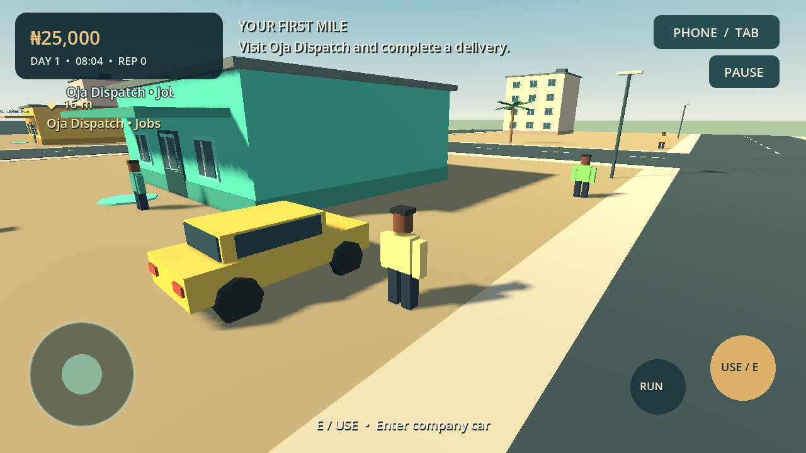

# Lagos Empire 3D: From Zero to Billions

An offline, landscape, third-person 3D Android game built with **Godot 4.6.3 stable** and GDScript. Start with ₦25,000 in a fictional Lagos-inspired district and earn, drive, trade and invest toward a billion-naira empire.

**Version 0.1 is a connected playable foundation.** It includes real 3D exploration, physics collision, two driveable vehicle types, enterable homes, persistent finances and an Android export. The original procedural art is deliberately simple and stylised. It is not a finished large-scale, photorealistic open-world release, and Samsung performance has not been measured.

[Driving screenshot](docs/screenshots/driving.png) · [Phone map screenshot](docs/screenshots/map.png)

## Play

Open `project.godot` with Godot **4.6.3** and press F6 on `scenes/main.tscn` or F5. No asset download, backend, subscription or account is needed by the game.

For Android, download the APK from the GitHub Actions artifact **lagos-empire-3d-android-debug**, extract the artifact ZIP, copy the APK to the phone and open it. Allow installation from the app used to open the file when Android asks. This is a debug-signed arm64 build for testing, not a Play Store release. Separately generated debug keys may require uninstalling an older debug build before installing another; uninstalling deletes local saves.

## Included gameplay

- Main menu: New Game, Continue, Settings, Credits and Exit; save-aware new-game confirmation.
- A collision-enabled neighbourhood with roads, shops, banks, market stalls, pedestrians, parked yellow minibuses, palm trees and lagoon scenery.
- Walking, running, orbit camera, multi-touch joystick, interaction buttons and desktop controls.
- Eight-minute day/night cycle, with a paused clock during menus and optional rest in a home.
- Phone apps: Wallet, Jobs, Trade, Businesses, Properties, Vehicles, Investments, Map, Progress and Guide.
- Introductory quest: first delivery → first-car savings → Kora Compact purchase; one-time completion rewards.
- Six replayable jobs across delivery and passenger transport, with deadlines and actual location/vehicle checks.
- Wholesale crate trading between Ayo Market and Suya Junction.
- Upgradeable mini-mart and delivery company, revenue, costs, demand changes and repair setbacks.
- Fictional stock market with daily bounded volatility, mean reversion, transaction fees and persistent share ownership.
- Loans, daily interest, rent, fuel, collision damage, repairs, bank transfers, weekly bank interest and bankruptcy recovery.
- Kora Compact sedan and Oba Grand SUV; steering, acceleration, braking, reverse, ownership, storage and retrieval.
- Starter rented room and purchasable mansion, enterable interiors, furnishings and mansion garage.
- Net-worth milestones through ₦1 billion and one-time cash/reputation rewards.
- Local atomic saves with validation, backup recovery, automatic checkpoints and explicit saving.
- Original synthesized city, motor and interface sounds; Low, Medium and High presets.

## First ten minutes

1. Start a new game. Walk across the road to the gold Oja Dispatch marker and press USE.
2. Pick **First mile • documents**, close the phone, follow the waypoint to the bank, and press USE to deliver.
3. Return to Dispatch for more work. Passenger jobs supply the yellow company car. Enter it with USE, drive to the destination, stop and press USE to complete.
4. Save ₦45,000, visit Eko Motors and buy the Kora Compact. Retrieve it there and enter it.
5. Buy five crates at Ayo Market and sell them at Suya Junction, or reinvest earnings in a business.
6. Use the Map app to mark other destinations. Active jobs temporarily take waypoint priority.

## Source layout

| File / directory | Purpose |
| --- | --- |
| `scenes/` | Main, player, vehicle and neighbourhood scenes |
| `scripts/economy.gd` | `EconomyManager`, autoloaded as `Economy`; authoritative financial transactions and persistence |
| `scripts/catalog.gd` | Location, property, vehicle, business, job and stock registries |
| `scripts/world.gd`, `scripts/geometry.gd` | Original world generation, collision and spatial MultiMesh batching |
| `scripts/player.gd`, `scripts/vehicle.gd` | Reusable walking and driving controllers |
| `scripts/main.gd` | Interaction and lifecycle coordination, phone actions and transitions |
| `scripts/ui.gd`, `scripts/touch_controls.gd`, `scripts/district_map.gd` | Responsive game interface and input |
| `tests/` | Behavioural economy/gameplay tests and screenshot capture harness |
| `tools/` | Validation, Android configuration and original audio generation |
| `.github/workflows/android.yml` | Pinned-engine automated APK build and artifact upload |

## Build, controls and evidence

- [Android setup and export](docs/ANDROID_BUILD.md)
- [Controls guide](docs/CONTROLS.md)
- [Economic rules and transaction guarantees](docs/ECONOMY.md)
- [Test results and limits](docs/TEST_RESULTS.md)
- [Asset licence manifest](ASSET_LICENSES.md)
- [Current build status](BUILD_STATUS.md)
- [Remaining work](NEXT_STEPS.md)

The game has no runtime network features. A successful export and signature check do **not** establish successful installation, touch ergonomics, sustained frame rate or thermal behaviour on a real phone.
