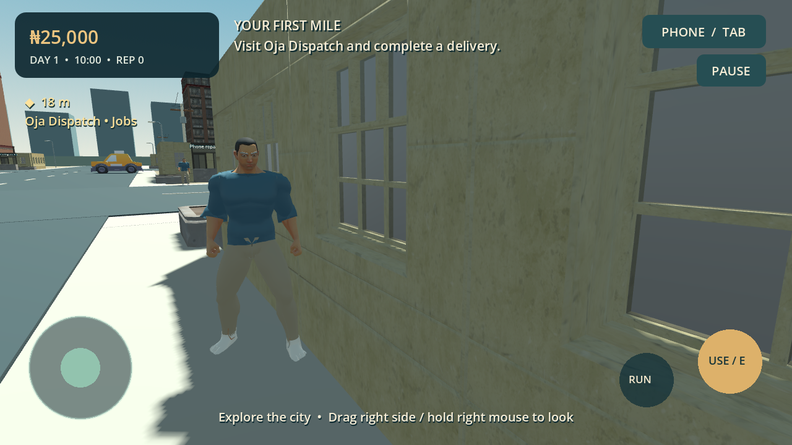

# Lagos Empire 3D: From Zero to Billions

An offline, landscape, third-person 3D Android game built with **Godot 4.6.3 stable** and GDScript. Start with ₦25,000 in a fictional Lagos-inspired district and earn, drive, trade and invest toward a billion-naira empire.

**Version 0.2 is an integrated visual and living-economy alpha.** It upgrades the existing game with a rigged animated humanoid, imported textured architecture, original detailed SUV/sports-car GLBs, a villa, three enterable homes and a seeded economic sandbox. It remains stylised and needs further art direction, physical Android tests and performance tuning before any production-ready claim.

[SUV](docs/screenshots/upgrade-suv.png) · [Sports car](docs/screenshots/upgrade-sports.png) · [City](docs/screenshots/upgrade-city.png) · [Mansion](docs/screenshots/upgrade-mansion.png) · [Interior](docs/screenshots/upgrade-interior.png) · [Economy](docs/screenshots/upgrade-economy.png)

## Play

Open `project.godot` with Godot **4.6.3** and press F6 on `scenes/main.tscn` or F5. No asset download, backend, subscription or account is needed by the game.

For Android, use the delivered local debug APK. Once this source is pushed to an accessible repository and its workflow succeeds, download the GitHub Actions artifact **lagos-empire-3d-android-debug**, extract the artifact ZIP, copy the APK to the phone and open it. Allow installation from the app used to open the file when Android asks. This is a debug-signed arm64 build for testing, not a Play Store release. Separately generated debug keys may require uninstalling an older debug build before installing another; uninstalling deletes local saves.

## Included gameplay

- Main menu: New Game, Continue, Settings, Credits and Exit; save-aware new-game confirmation.
- A collision-enabled neighbourhood with roads, shops, banks, market stalls, pedestrians, parked company vehicles, palm trees and lagoon scenery.
- Walking, running, orbit camera, multi-touch joystick, interaction buttons and desktop controls.
- Eight-minute day/night cycle, with a paused clock during menus and optional rest in a home.
- Phone apps: Wallet, Jobs, Trade, Businesses, Properties, Vehicles, Investments, Map, Progress, Contacts, News, Statistics and Guide.
- Introductory quest: first delivery → first-car savings → Kora Compact purchase; one-time completion rewards.
- Six authored jobs plus four context-dependent offers: delivery, transport, supply and trusted express; deadlines, history, cargo and reputation checks.
- Wholesale crate trading between Ayo Market and Suya Junction.
- Seven unified business categories from mini-mart to holding company, with scheduled revenue, salaries, costs, supply/competition effects, profits and losses.
- Fictional stock market with daily bounded volatility, mean reversion, transaction fees and persistent share ownership.
- Loans, daily interest, rent, fuel, collision damage, repairs, bank transfers, weekly bank interest and bankruptcy recovery.
- Kora Compact sedan, Oba Grand SUV and Adura GT sports car; steering, acceleration, braking, reverse, ownership, storage and retrieval.
- Starter room, purchasable duplex and mansion, enterable interiors, furnishings and mansion garage.
- Net-worth milestones through ₦10 trillion and one-time capped cash/reputation rewards.
- Versioned local atomic saves with original-save migration, validation, backup recovery, automatic checkpoints and explicit saving.
- Original synthesized city, motor and interface sounds; Low, Medium and High presets.

## First ten minutes

1. Start a new game. Walk across the road to the gold Oja Dispatch marker and press USE.
2. Pick **First mile • documents**, close the phone, follow the waypoint to the bank, and press USE to deliver.
3. Return to Dispatch for more work. Passenger jobs supply the yellow company car. Enter it with USE, drive to the destination, stop and press USE to complete.
4. Save ₦45,000, visit Eko Motors and buy the Kora Compact. Retrieve it there and enter it.
5. Buy five crates at Ayo Market and sell them at Suya Junction, or reinvest earnings in a business.
6. Use the Map app to mark other destinations. Active jobs temporarily take waypoint priority.

## Source layout

| File / directory | Purpose |
| --- | --- |
| `scenes/` | Main, player, vehicle and neighbourhood scenes |
| `scripts/economy.gd` | `EconomyManager`, autoloaded as `Economy`; authoritative financial transactions and persistence |
| `scripts/economic_simulation.gd`, `data/sectors.json`, `scripts/money.gd` | Scheduled sector cycles, rivals, business reports and bounded int64 accounting |
| `scripts/actor.gd`, `scripts/art.gd`, `assets/imported/` | Skinned character state logic, imported meshes, shared material batching |
| `scripts/catalog.gd` | Location, property, vehicle, business, job and stock registries |
| `scripts/world.gd`, `scripts/geometry.gd` | Original world generation, collision and spatial MultiMesh batching |
| `scripts/player.gd`, `scripts/vehicle.gd` | Reusable walking and driving controllers |
| `scripts/main.gd` | Interaction and lifecycle coordination, phone actions and transitions |
| `scripts/ui.gd`, `scripts/touch_controls.gd`, `scripts/district_map.gd` | Responsive game interface and input |
| `tests/` | Behavioural economy/gameplay tests and screenshot capture harness |
| `tools/` | Validation, Android configuration and original audio generation |
| `.github/workflows/android.yml` | Pinned-engine automated APK build and artifact upload |

## Build, controls and evidence

- [Android setup and export](docs/ANDROID_BUILD.md)
- [Controls guide](docs/CONTROLS.md)
- [Economic rules and transaction guarantees](docs/ECONOMY.md)
- [Test results and limits](docs/TEST_RESULTS.md)
- [Asset licence manifest](ASSET_LICENSES.md)
- [Current build status](BUILD_STATUS.md)
- [Remaining work](NEXT_STEPS.md)

The game has no runtime network features. A successful export and signature check do **not** establish successful installation, touch ergonomics, sustained frame rate or thermal behaviour on a real phone.
